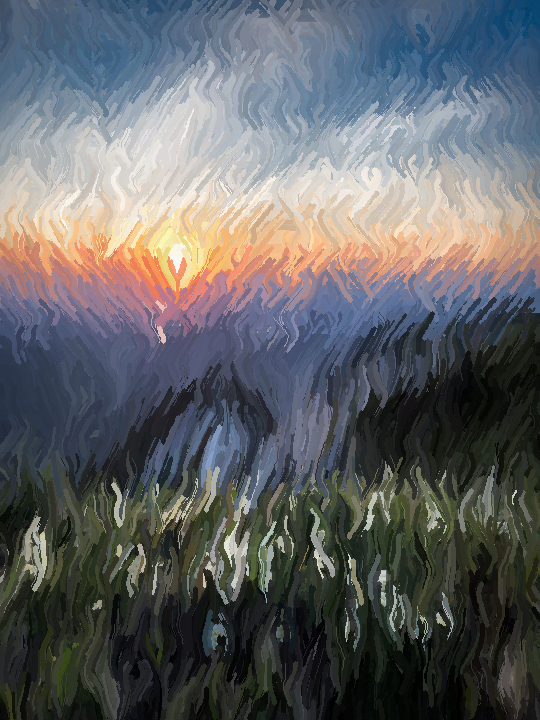
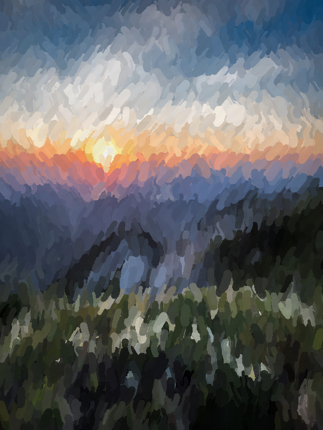

# isophote

Turn photos into paintings that look hand-painted — entirely in your browser, instantly, with nothing uploaded anywhere.

**[Try it now](https://jordandubu.github.io/isophote/)** — no install, no account, no server processing. Your photos stay on your device.

<p align="center">
  <a href="https://jordandubu.github.io/isophote/"></a>
  <a href="https://jordandubu.github.io/isophote/"></a>
</p>
<p align="center"><sub>Same photo (left in <a href="docs/example_photo.jpg">docs/</a>), two presets: <b>Art</b> and <b>Impasto</b>. Rendered in ~0.6s in the browser.</sub></p>

## Why isophote

Most "oil paint" filters smudge pixels in place and look like noise. isophote paints the way a painter does:

- **Strokes follow the subject** — each brush stroke is a polyline that walks along the image's contours (structure-tensor isophote field), so lines curve around eyes, petals, and horizon lines instead of cutting across them
- **Long, thin, layered** — strokes overlap in passes with per-stroke jitter, like paint laid down in layers
- **Real texture** — optional canvas-weave relief with normal-map lighting, so result catches light like a physical print
- **Deterministic seeds** — every render is reproducible; share a seed and settings, get the identical painting

## Use it in the browser

Open [jordandubu.github.io/isophote](https://jordandubu.github.io/isophote/), drop a photo (or paste one) → done. Live sliders re-render as you tweak; the hamburger menu holds the effects on phones. When it looks right, hit **Export** to save the PNG.

The render runs on **Rust compiled to WebAssembly** — your browser does all the compute, and the site is fully static.

## Use it from the command line

The same filter is a standalone Python tool (OpenCV), no editor needed:

```bash
pip install opencv-python numpy
python isophote.py photo.jpg -o painted.png --len 45 --width 3 --layers 4 --relief 0.1
```

All knobs with defaults:

| flag | default | meaning |
|---|---|---|
| `--len` | 26 | stroke length, px (long = 40–70) |
| `--width` | 7 | stroke thickness, px (thin = 3–5) |
| `--layers` | 2 | paint passes (more = denser) |
| `--density` | auto | stroke count (auto ≈ area / 140) |
| `--base-radius` | 6 | Kuwahara base flattening |
| `--flow-smooth` | 0 | flow-orientation smoothing |
| `--no-canvas` | off | disable canvas weave |
| `--relief` | 0.35 | canvas relief strength (0 = flat) |
| `--seed` | 42 | stroke randomness |

**Recipes:** long + thin → `--len 45 --width 3 --layers 4` · chunky impasto → `--len 24 --width 9 --layers 2 --relief 0.3` · soft pastel → `--len 30 --width 5 --relief 0 --base-radius 8`

## How it works

1. **Kuwahara base** — quadrant min-variance flatten (edge-preserving, painterly backdrop)
2. **Flow field** — structure tensor of the smoothed grayscale: orientation = isophote (equal-brightness contour) direction, coherence = anisotropy strength
3. **Coherent smoothing** — orientations averaged weighted by coherence, so flat regions inherit nearby directions instead of turning noisy
4. **Strokes** — polylines walking the flow with direction inertia, color sampled from the original under the stroke midpoint, per-stroke luminance jitter, gradient-first ordering
5. **Canvas relief** — procedural weave heightmap → normal map → Lambert shading

## Use it inside Blender

The repo ships a Blender add-on (`addon/painterly_normals/`) that bridges the web app into your material workflow:

- **Send to Isophote** — bakes the object's normal map and opens it in the isophote web app
- **Apply from Isophote** — pulls the painted result back and wires it into the material as a normal map
- **Apply animated (seeds)** — receives multiple seed-variations the app painted (Send dropdown → *Send animated (10 seeds)*) and wires them as a playing image sequence, giving a flickering hand-painted animation when you play the timeline

Install: download [painterly_normals-0.4.0-isophote.zip](../../releases) (or zip the `addon/painterly_normals/` folder yourself), then Blender → *Preferences → Add-ons → Install from Disk*. The add-on is pure Python — no numpy/cv2 required; all painting happens in your browser.

The browser core is a Rust port of the same pipeline ([`rust/`](rust/)); it's **bit-exact** on the seeded RNG (PCG64 mirror of NumPy) and verified stage-by-stage against the Python/OpenCV reference.

## Repository map

| path | what |
|---|---|
| `addon/painterly_normals/` | Blender add-on (pure Python bridge to the web app) |
| `app/` | static web app (index.html, wasm glue, compiled wasm) — **what the live site serves** |
| `rust/` | Rust crate: PCG64 + full pipeline, parity tests against fixtures |
| `isophote.py` | standalone Python CLI |
| `serve.py` | tiny static server used in development (`python3 serve.py` → :8799) |
| `web.py` | older server-compute UI, kept as a parity oracle |
| `docs/` | images used by this README |

## License

MIT — see [LICENSE](LICENSE).
